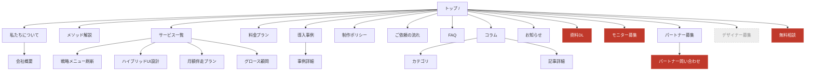

# ホームページ サイトマップ（v1.0）

作成日：2026-11-16
元資料：事業計画書「飲食店専門グラフィック・メニューデザイン事業」

---

## 1. サイト設計の前提

### サイトの役割
「見た目の良いメニューを作る会社」ではなく、**「データと行動経済学で利益を生むメニューを設計する会社」**であることを伝え、以下の3つの成果を出すことを目的とする。

| # | 目的 | 主なKPI |
| :-- | :-- | :-- |
| 1 | 飲食店経営者からの **無料相談・単発制作（戦略メニュー刷新パック）** の獲得 | 問い合わせ数 / 資料DL数 |
| 2 | POSベンダー・厨房機器商社などの **アライアンスパートナー** の獲得 | パートナー問い合わせ数 |
| 3 | 立ち上げ期の **モニター店舗（3〜5店舗）** の募集と実績づくり | モニター応募数 |

### 想定ユーザー
| ユーザー | 知りたいこと | ゴール（CV） |
| :-- | :-- | :-- |
| **A. 飲食店経営者**（メイン：客単価3,000〜8,000円、個人繁盛店〜10店舗規模） | 値上げしても客が離れないか / 客単価は本当に上がるか / 費用はいくらか | 無料相談・資料DL |
| **B. アライアンスパートナー**（POS・モバイルオーダーベンダー、厨房機器商社、店舗仲介、営業代行） | 紹介すると自社顧客にどんなメリットがあるか / 紹介料の仕組み | パートナー問い合わせ |
| **C. 外部デザイナー**（Phase 3〜） | 仕事内容・報酬・体制 | 登録応募 |

---

## 2. サイトツリー

```
/ （トップ）
│
├── /about/ ………………………………… 私たちについて
│   └── /about/company/ ………………… 会社概要・代表プロフィール
│
├── /method/ ………………………………… 利益を生むメニューの仕組み（メソッド解説）
│
├── /service/ ……………………………… サービス一覧
│   ├── /service/menu-engineering/ … 戦略メニュー刷新（POS分析×メニューエンジニアリング）
│   ├── /service/hybrid-ui/ ……………… 紙メニュー×モバイルオーダー ハイブリッド設計
│   ├── /service/subscription/ ………… 月額伴走プラン（ライト／スタンダード）
│   └── /service/growth/ ………………… グロース顧問（POS分析・MEO・LINE運用）
│
├── /price/ ………………………………… 料金プラン（成果報酬・二次使用料・著作権譲渡含む）
│
├── /works/ ………………………………… 導入事例・ケーススタディ（業態別フィルタ）
│   └── /works/[slug]/ ………………… 事例詳細（Before/After・客単価推移）
│
├── /quality/ ……………………………… 制作ポリシー（料理写真100%実写・AI利用ガイドライン）
│
├── /flow/ …………………………………… ご依頼の流れ
├── /faq/ …………………………………… よくある質問
│
├── /column/ ……………………………… お役立ちコラム（SEO）
│   ├── /column/category/[slug]/ …… カテゴリ一覧
│   └── /column/[slug]/ ………………… 記事詳細
│
├── /news/ ………………………………… お知らせ
│   └── /news/[slug]/
│
├── /download/ …………………………… 資料ダウンロード（リード獲得）
│   └── /download/thanks/
│
├── /monitor/ ……………………………… モニター店舗募集【Phase 1 限定】
│
├── /partner/ ……………………………… アライアンスパートナー募集（B向け）
│   └── /partner/contact/ ……………… パートナー専用問い合わせ
│
├── /recruit/ ……………………………… パートナーデザイナー募集【Phase 3〜】
│
├── /contact/ ……………………………… 無料相談・お問い合わせ
│   ├── /contact/confirm/
│   └── /contact/thanks/
│
├── /privacy/ ……………………………… プライバシーポリシー
├── /terms/ ………………………………… サイト利用規約
└── /404 ……………………………………… ページが見つかりません
```

### 階層図（Mermaid）



---

## 3. ページ別の役割と主要コンテンツ

### 3-1. 集客・信頼形成

| ID | ページ | URL | 役割 | 主要コンテンツ | 主CTA |
| :-- | :-- | :-- | :-- | :-- | :-- |
| P01 | トップ | `/` | 事業コンセプトを3秒で伝え、各ページへ振り分ける | キャッチコピー「『装飾』から『利益を生む仕組み』へ」／三重苦（インフレ・モバイルオーダー・発注の手間）への共感／解決策3本柱／実績数値（客単価＋10〜15%）／料金の入口／事例／パートナー向け導線 | 無料相談・資料DL |
| P02 | 私たちについて | `/about/` | 「デザイン会社ではなく利益設計パートナー」という立ち位置の説明 | ミッション／他社（格安作業代行）との違い／提供価値 | 無料相談 |
| P03 | 会社概要 | `/about/company/` | 信頼担保 | 代表プロフィール・経歴／所在地／事業内容／提携先 | ― |
| P04 | メソッド解説 | `/method/` | **差別化の中核ページ**。理論を分かりやすく可視化 | ABC分析（人気度×利益率の4象限）／アンカリング・松竹梅／端数価格／シズル感とストーリー／クロスセル導線／値上げを納得させる見せ方 | 資料DL |
| P05 | 制作ポリシー | `/quality/` | 景品表示法リスクへの姿勢を示し、安心感を与える | 料理写真は100%実写／AIは背景・装飾のみ／権利チェック体制／ユポ紙・PP加工など耐久仕様 | 無料相談 |

### 3-2. サービス・料金

| ID | ページ | URL | 役割 | 主要コンテンツ | 主CTA |
| :-- | :-- | :-- | :-- | :-- | :-- |
| P06 | サービス一覧 | `/service/` | 4サービスの全体像と「単発→伴走→顧問」の段階を示す | ステップ図（刷新→伴走→顧問）／各サービスの要約カード | 各詳細へ |
| P07 | 戦略メニュー刷新 | `/service/menu-engineering/` | **フロントエンド商品の販売ページ** | 対象店舗／POSデータABC分析の流れ／納品物（紙＋モバイル画像）／印刷手配／料金8〜15万円／事例 | 無料相談 |
| P08 | ハイブリッドUI設計 | `/service/hybrid-ui/` | モバイルオーダー導入店舗の悩みに応える | 紙＝プレゼン媒体、デジタル＝注文完結の役割分担／多言語・アレルギー表示／対応POS・モバイルオーダー一覧 | 無料相談 |
| P09 | 月額伴走プラン | `/service/subscription/` | サブスクへの移行を促す | ライト（月4万）とスタンダード（月8万）の比較／年間販促カレンダー／月次振り返り／都度見積もり不要のメリット | 無料相談 |
| P10 | グロース顧問 | `/service/growth/` | 上位プランの説明（2年目以降に強化） | 月次POS詳細分析／MEO対策／LINE公式運用支援／月15万円〜 | 無料相談 |
| P11 | 料金プラン | `/price/` | 料金を一覧で示し、価格の根拠を説明 | 全プラン比較表／成果報酬オプション（基本料＋対象売上5%）／修正回数の規定／二次使用料・著作権譲渡・元データ買取の料金／印刷費の考え方 | 無料相談・資料DL |

### 3-3. 実績・検討材料

| ID | ページ | URL | 役割 | 主要コンテンツ | 主CTA |
| :-- | :-- | :-- | :-- | :-- | :-- |
| P12 | 導入事例一覧 | `/works/` | 成果の証明 | 業態（居酒屋／カフェ／ダイニング）・課題別フィルタ／客単価UP率をカードに表示 | 事例詳細へ |
| P13 | 導入事例詳細 | `/works/[slug]/` | ケーススタディ | 店舗の課題／分析結果（4象限図）／施策／Before・After画像／客単価・注文数の推移グラフ／オーナーの声 | 無料相談 |
| P14 | ご依頼の流れ | `/flow/` | 発注までの不安をなくす | 相談→POSデータ共有→分析→設計→制作→印刷・納品→効果測定→伴走提案 | 無料相談 |
| P15 | よくある質問 | `/faq/` | 想定される疑問への回答 | 対応POS／遠方対応／撮影の有無／修正回数／データの権利／解約条件 | 無料相談 |

### 3-4. 記事・情報発信

| ID | ページ | URL | 役割 | 主要コンテンツ | 主CTA |
| :-- | :-- | :-- | :-- | :-- | :-- |
| P16 | コラム一覧 | `/column/` | 検索流入（SEO）の受け皿 | 新着／人気記事／カテゴリ | 資料DL |
| P17 | コラムカテゴリ | `/column/category/[slug]/` | テーマ別の記事一覧 | カテゴリ案：値上げ・価格戦略／メニューエンジニアリング／モバイルオーダー活用／販促カレンダー／法務・景品表示法 | 資料DL |
| P18 | コラム記事 | `/column/[slug]/` | 見込み客の育成 | 記事本文／関連サービス／関連記事 | 資料DL・無料相談 |
| P19 | お知らせ一覧 | `/news/` | 更新情報・提携発表 | ― | ― |
| P20 | お知らせ詳細 | `/news/[slug]/` | ― | ― | ― |

### 3-5. コンバージョン（CV）

| ID | ページ | URL | 役割 | 主要コンテンツ |
| :-- | :-- | :-- | :-- | :-- |
| P21 | 資料ダウンロード | `/download/` | すぐに相談しない層のメールアドレス獲得 | サービス資料／「値上げで客が離れないメニュー改定チェックリスト」／「年間販促カレンダー」テンプレート |
| P22 | 資料DL完了 | `/download/thanks/` | 次の行動へ誘導 | DLリンク／無料相談への誘導 |
| P23 | モニター店舗募集 | `/monitor/` | **Phase 1の最重要ページ**。実績づくり | 募集条件（POS導入済み等）／特別条件／実績公開への協力内容／募集枠数／応募フォーム |
| P24 | 無料相談・お問い合わせ | `/contact/` | メインCV | 相談種別（メニュー刷新／伴走／顧問／その他）／業態・店舗数・使用POS・客単価の入力欄 |
| P25 | 入力内容確認 | `/contact/confirm/` | ― | ― |
| P26 | 送信完了 | `/contact/thanks/` | ― | 今後の流れ／コラムへの誘導 |

### 3-6. パートナー・採用

| ID | ページ | URL | 役割 | 主要コンテンツ | 主CTA |
| :-- | :-- | :-- | :-- | :-- | :-- |
| P27 | パートナー募集 | `/partner/` | **アライアンス営業の受け皿**（飛び込み営業をしない方針の要） | 提携先の種類（POS／モバイルオーダー／厨房機器／店舗仲介／営業代行）／パートナー側のメリット（導入後の定着率向上・顧客満足）／紹介フローと紹介料の仕組み／提携実績 | パートナー問い合わせ |
| P28 | パートナー問い合わせ | `/partner/contact/` | B向け専用フォーム | 会社名／業種／取引店舗数／提携の形 | ― |
| P29 | デザイナー募集 | `/recruit/` | Phase 3の外注体制づくり | 業務内容（定型バナー・DTP流し込み）／報酬体系／使用ツール／応募フォーム | 応募 |

### 3-7. 規約・システム

| ID | ページ | URL | 備考 |
| :-- | :-- | :-- | :-- |
| P30 | プライバシーポリシー | `/privacy/` | POSデータなど店舗情報の取り扱いを明記 |
| P31 | サイト利用規約 | `/terms/` | コンテンツ・資料の著作権について明記 |
| P32 | 404 | `/404` | トップ・サービス・相談への導線 |

---

## 4. ナビゲーション設計

### グローバルナビ（ヘッダー）
```
[ロゴ]  メソッド ｜ サービス▼ ｜ 料金 ｜ 導入事例 ｜ コラム ｜ [資料DL] [無料相談する]
                    ├ 戦略メニュー刷新
                    ├ ハイブリッドUI設計
                    ├ 月額伴走プラン
                    └ グロース顧問
```
- 「無料相談する」は色付きの目立つボタン、「資料DL」は枠線だけの控えめなボタンにする
- スマホでは画面下部に「資料DL／無料相談」の固定バーを表示する
- Phase 1の間は「導入事例」の代わりに「モニター募集」をナビに置く

### フッター
```
サービス          会社情報          お役立ち          パートナーの方へ
・戦略メニュー刷新  ・私たちについて    ・コラム          ・パートナー募集
・ハイブリッドUI設計 ・会社概要         ・資料ダウンロード  ・デザイナー募集
・月額伴走プラン    ・制作ポリシー      ・よくある質問
・グロース顧問      ・お知らせ         ・ご依頼の流れ
・料金プラン
──────────────────────────────────────────
プライバシーポリシー ｜ サイト利用規約 ｜ © 20XX ○○○
```

---

## 5. ユーザー別の導線

```
【A. 飲食店経営者：検索から来た場合】
  コラム記事（例：値上げしても客が離れないメニューの作り方）
    → メソッド解説 → 資料DL ………………………………………… 見込み客として獲得
    → （メール配信で育成）→ 導入事例 → 料金 → 無料相談

【A. 飲食店経営者：紹介・指名で来た場合】
  トップ → 戦略メニュー刷新 → 導入事例 → 料金 → 無料相談

【A'. モバイルオーダーを導入済みの店舗】
  トップ → ハイブリッドUI設計 → FAQ（対応POS）→ 無料相談

【B. アライアンスパートナー】
  トップ（フッター・専用バナー）→ パートナー募集 → 導入事例（成果の確認）→ パートナー問い合わせ

【C. デザイナー】
  フッター → デザイナー募集 → 応募
```

---

## 6. 公開フェーズ（事業ロードマップとの対応）

| フェーズ | 時期 | 公開・更新するページ | ねらい |
| :-- | :-- | :-- | :-- |
| **Phase 1：最小構成で公開** | 1〜3ヶ月目 | P01〜P11、P14〜P15、P21〜P26、P30〜P32、**P23 モニター募集** | 実績がなくても成り立つ構成。メソッドと制作ポリシーで専門性を示し、モニター店舗を募集する |
| **Phase 2：実績公開・パートナー開拓** | 4〜12ヶ月目 | P12〜P13 導入事例、**P27〜P28 パートナー募集**、P16〜P20 コラム・お知らせ（モニター募集は終了） | 数値の実績を出してパートナーとの提携を進める。コラムで検索流入を積み上げる |
| **Phase 3：顧問拡大・体制強化** | 2年目〜 | P10 グロース顧問の強化、**P29 デザイナー募集** | 上位プランの販売と外注体制づくり |

> 補足：Phase 1でもP12（導入事例）を「準備中」とせず、ナビから外しておく。空のページは信頼を下げるため。

---

## 7. 次の工程（案）

1. 各ページの**ワイヤーフレーム**作成（優先：P01 トップ、P07 戦略メニュー刷新、P23 モニター募集）
2. 資料DL用の**ダウンロード資料**の企画（チェックリスト・販促カレンダー）
3. コラムの**キーワード設計**（「メニュー 値上げ 見せ方」「メニューエンジニアリング」「モバイルオーダー 客単価」など）
4. CMS・制作方法の決定（例：WordPress／Studio／Next.js＋ヘッドレスCMS）
